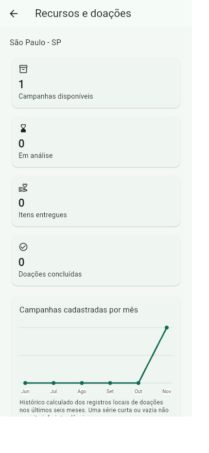

# DoaCerto

Plataforma da Global Solution 2026 que conecta doadores, empresas e instituições que precisam de recursos.

## Funcionalidades

- Cadastro e oferta de doações, mapa e histórico.
- Assistente de IA para dúvidas sobre a plataforma, doações e organizações.
- Recomendações estruturadas de organizações e links de rota.
- Avaliação visual de imagens enviadas no chat (Gemini ou OpenAI com visão).
- Histórico de conversa temporário no backend.
- Interface web adaptada a celulares, tablets e desktops.

## Experiência mobile na web

Em larguras de até 768 px, as áreas de doador e empresa usam navegação inferior fixa com botões grandes, cabeçalho compacto e ação de saída acessível. Chat, mapa, formulários e cards reorganizam espaçamentos e dimensões para toque e leitura em telas estreitas; a navegação respeita a área segura inferior de dispositivos móveis. Esta é a versão responsiva do site, não um aplicativo nativo instalável.

## Capturas do aplicativo Flutter

O app mobile complementa a plataforma web com navegação e telas adaptadas para dispositivos móveis.

| Login | Dashboard |
|---|---|
|  |  |

| Mapa de doações | Assistente |
|---|---|
|  |  |

| Nova doação | Inteligência territorial |
|---|---|
|  |  |

## Tecnologias

- Frontend: React (Create React App).
- Backend: Node.js e Express.
- IA: Google Gemini e OpenAI, configurados exclusivamente no backend.
- Persistência atual: arquivo JSON; histórico de conversa mantido em memória no servidor.

## Configuração da IA

O chatbot exige uma chave válida de pelo menos um provedor. Sem ela, o sistema não inventa uma resposta fixa: o chat informa que precisa ser configurado.

1. Obtenha uma chave de API do Google AI Studio ou da OpenAI.
2. Na pasta `src/server`, copie `.env.example` para `.env` e preencha **uma** chave:

   ```env
   GEMINI_API_KEY=sua_chave
   GEMINI_MODEL=gemini-3.8-flash
   GEMINI_FALLBACK_MODELS=gemini-3.6-flash,gemini-3.5-flash
   ```

   Ou use OpenAI:

   ```env
   OPENAI_API_KEY=sua_chave
   OPENAI_MODEL=gpt-4o-mini
   ```

Se as duas chaves forem fornecidas, o backend usa OpenAI para texto e prioriza Gemini para imagens, com o outro provedor como alternativa em caso de falha. Se um modelo Gemini estiver indisponível, o servidor tenta os modelos definidos em `GEMINI_FALLBACK_MODELS`. Os modelos podem ser ajustados pelas variáveis de ambiente.
3. Não envie, publique ou versione `src/server/.env`. As chaves nunca devem ser colocadas no React ou em variáveis `REACT_APP_*`.
4. Instale as dependências na raiz e inicie o backend:

   ```powershell
   npm install
   node src/server/server.js
   ```

5. Em outro terminal, inicie a interface:

   ```powershell
   npm start
   ```
   Por padrão, o frontend conversa com `http://localhost:3001`. Para outro endereço, defina `REACT_APP_API_URL` antes de iniciar/compilar a interface.

## API do assistente

| Método | Rota | Uso |
|---|---|---|
| GET | `/api/chat/status` | Informa se há provedor configurado, sem revelar chaves |
| POST | `/api/chat` | Envia mensagem, histórico validado e imagem opcional |
| DELETE | `/api/chat/:conversationId` | Remove a memória temporária da conversa |

O endpoint de chat limita mensagens a 4.000 caracteres, imagens JPEG/PNG/WebP a 5 MB e 20 requisições por minuto por endereço IP. O histórico é limitado a 20 mensagens e expira após duas horas. Como ele fica em memória, reiniciar o backend apaga as conversas.

## Contexto e privacidade

- O backend prepara um contexto reduzido para a IA: itens e status de doações e dados públicos das organizações.
- Contas, credenciais, IDs de usuários, nomes de doadores/empresas, contatos privados e imagens salvas de doações não são enviados como contexto.
- Uma imagem enviada pelo usuário é encaminhada ao provedor multimodal escolhido para ser avaliada.
- As recomendações de organizações são calculadas pelo backend e devolvidas separadamente da resposta textual, junto de endereço e rota.
- A aplicação ainda usa persistência JSON e não possui autenticação completa nem controle de acesso de produção. Restrinja a API e configure CORS antes de publicar o serviço na internet.

## Testes

```powershell
npm run test:server
npm run build
```

## Executar o aplicativo Flutter

O aplicativo mobile fica em `C:\Users\SeuUsuario\doacerto_mobile` e usa o mesmo backend. Inicie o backend primeiro. Para emulador Android:

[Baixar APK para Android — DoaCerto Mobile 1.0.0](https://github.com/Gui-Ferraz-Medeiros/GS-doa-certo-mobile/releases/download/v1.0.0/app-release.apk).

```powershell
flutter run
```

Para aparelho físico ou outro host, configure a URL acessível:

```powershell
flutter run --dart-define=DOACERTO_API_URL=http://IP_DO_COMPUTADOR:3001
```
