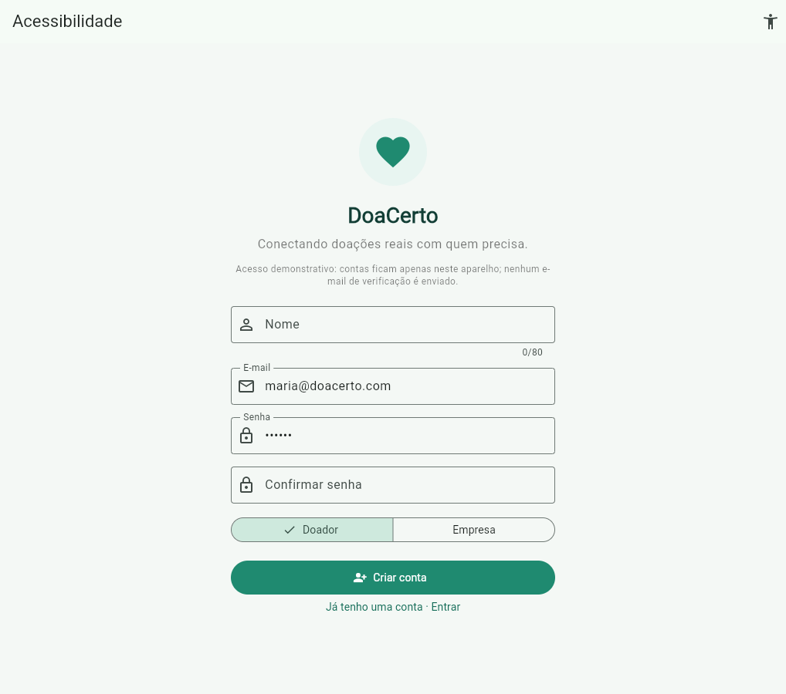
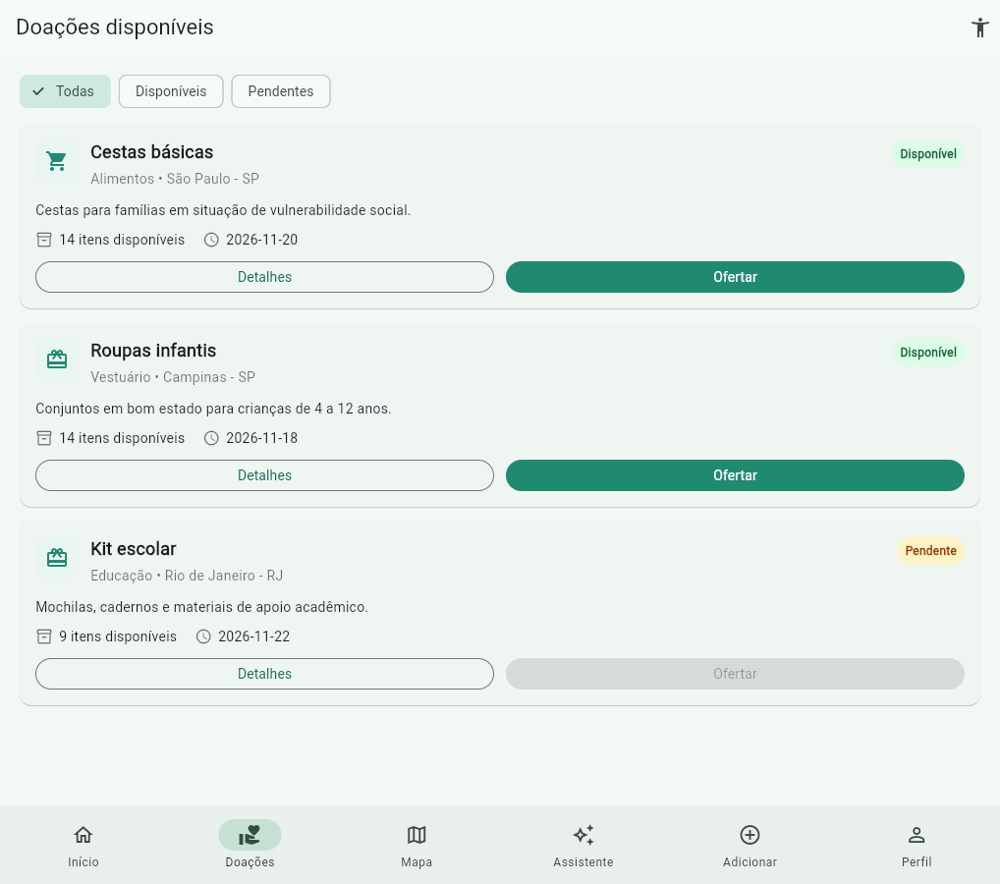
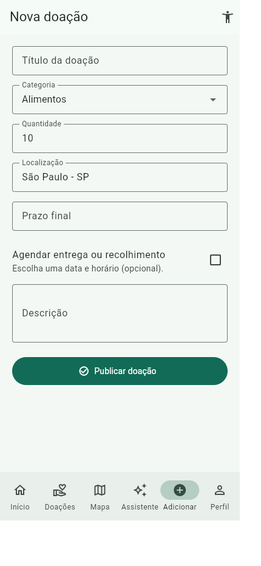
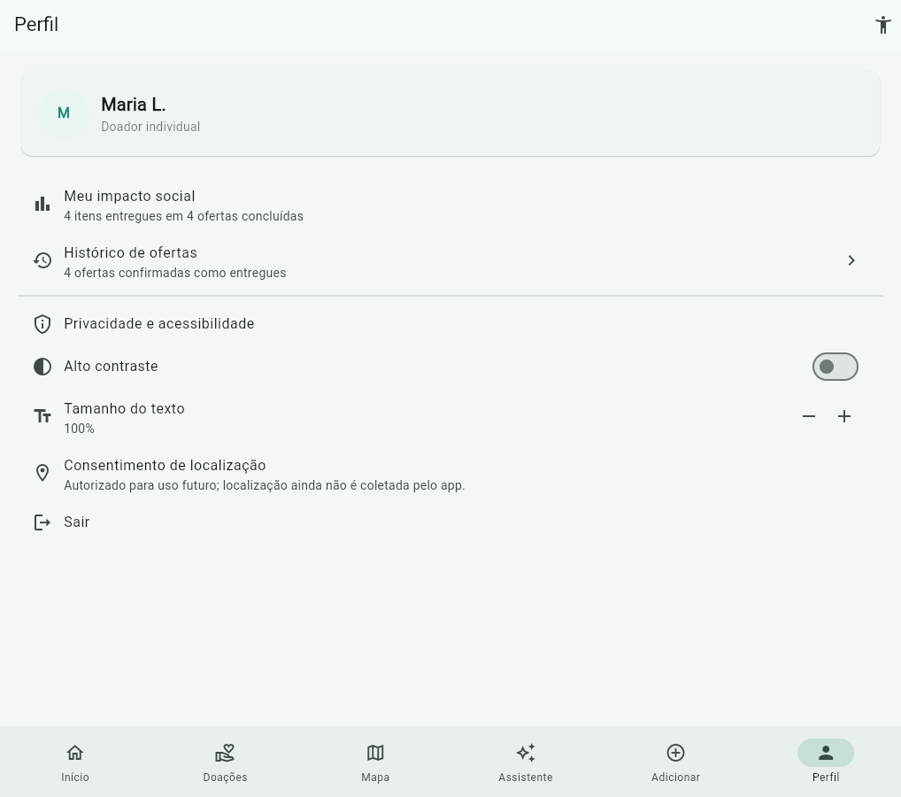
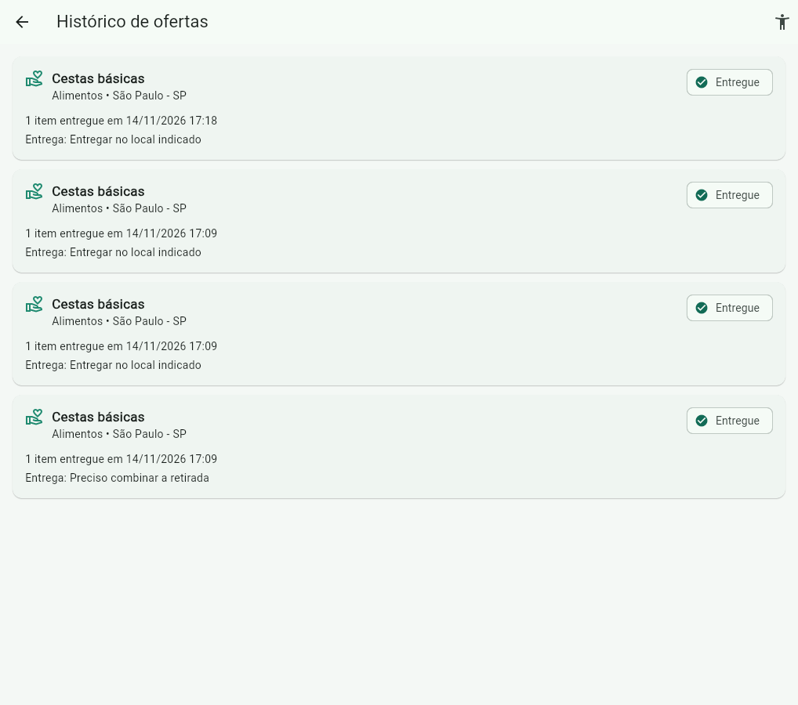
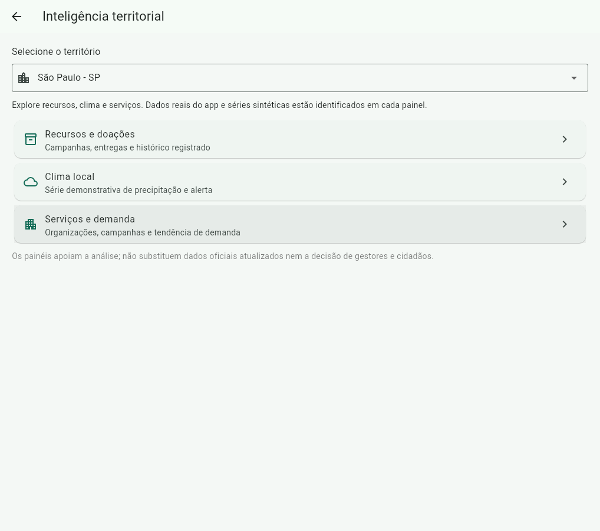
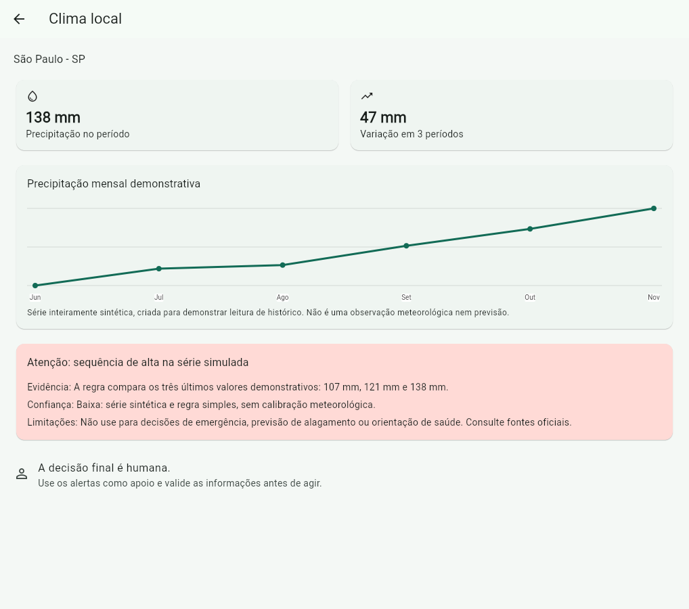
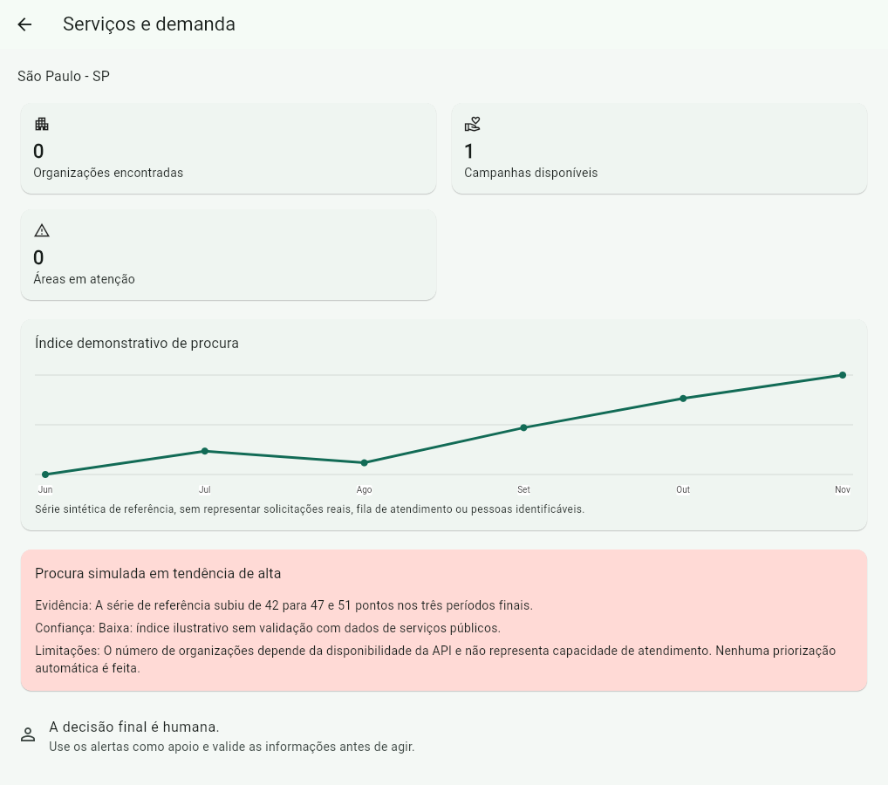

# DoaCerto Mobile

<p align="center">
  
</p>

**Tecnologia que aproxima doações de quem precisa.** App Flutter de inteligência territorial para conectar doadores, empresas e organizações a campanhas e necessidades locais.

## 1. Cabeçalho

Nome do app, logo e frase-resumo da solução estão apresentados no início deste README.

## 2. Problema e público

Doações podem não chegar a quem precisa por falta de informações reunidas sobre campanhas, itens aceitos, localização e prazos. O DoaCerto foi criado para doadores individuais, empresas, organizações sociais e gestores que precisam consultar recursos e instituições por território. Espera-se facilitar o encontro entre ofertas e necessidades e apoiar decisões locais mais informadas. O app não mede impacto causal nem substitui serviços públicos ou a confirmação direta com uma instituição.

## 3. Integrantes

| Integrante | RM |
|---|---:|
| Guilherme Ferraz de Medeiros | 564743 |
| Roberto Marques Moreira | 564935 |
| Gabriel Jorge Coutinho | 565441 |

## 4. Demonstração visual

As capturas de todas as telas navegáveis do app Flutter estão salvas em `assets/screenshots/`; cada imagem tem uma legenda.

| Acesso | Cadastro de conta |
|---|---|
|  |  |

| Dashboard | Doações disponíveis |
|---|---|
|  |  |

| Mapa | Assistente |
|---|---|
|  |  |

| Nova doação | Detalhes da doação |
|---|---|
|  |  |

| Ofertar doação | Perfil e impacto |
|---|---|
|  |  |

| Histórico de ofertas | Inteligência territorial |
|---|---|
|  |  |

| Recursos e doações | Clima local |
|---|---|
|  |  |

| Serviços e demanda |
|---|
|  |

## 5. Funcionalidades

- [x] Cadastro e login demonstrativos, com validação local de credenciais.
- [x] Consulta de doações por lista, dashboard e mapa; visualização de detalhes e rotas externas.
- [x] Cadastro de doações com categoria, quantidade, localização, prazo, descrição e agendamento opcional.
- [x] Oferta de quantidade parcial, com fotos, observações, modalidade de entrega e agendamento.
- [x] Registro local da oferta confirmada como entregue; atualização do impacto pessoal, disponibilidade e histórico.
- [x] Mapa de organizações e campanhas, com indicadores de urgência baseados nos prazos cadastrados.
- [x] Painéis territoriais de recursos, clima e serviços, com evidências e limitações dos alertas.
- [x] Assistente conectado à API para dúvidas e recomendações de organizações.
- [x] Preferências de alto contraste, escala de texto e consentimento informativo de localização.

## 6. Dados e alertas

### Fontes e métricas

- **Organizações:** diretório demonstrativo servido por `GET /api/dados` a partir de `deployment/api/data/organizacoes_sp.json`. O diretório não tem atualização nem validação oficial em tempo real documentadas; endereço, itens aceitos, coordenadas e disponibilidade devem ser confirmados com cada organização.
- **Doações:** campanhas iniciais de demonstração e registros criados pelos usuários. Os registros e ofertas do Flutter ficam no armazenamento local do aparelho. Uma oferta confirmada é contabilizada como entregue no app, mas isso não comprova a entrega física.
- **Indicadores de impacto:** somam itens e ofertas marcados como entregues. Não estimam pessoas atendidas, massa doada ou CO₂ evitado.
- **Clima e procura por serviços:** séries inteiramente sintéticas, usadas para demonstrar gráficos e regras; não são observações, previsões meteorológicas, filas ou solicitações reais.
- **Urgência territorial:** considera o prazo cadastrado mais próximo por área: crítica se vencido ou em até 3 dias; atenção de 4 a 7 dias; posterior acima de 7 dias; sem prazo quando não existe data válida.
- **Tendência dos painéis sintéticos:** compara os três últimos pontos e indica sequência de alta apenas se cada ponto for maior que o anterior. O painel de recursos também conta registros dos últimos seis meses.
- **Assistente:** recebe a mensagem e um resumo agregado de doações e organizações. Uma imagem anexada ao chat é enviada ao Gemini configurado.

### Limitações, vieses e uso responsável

Os resultados dependem da atualidade, qualidade e cobertura dos cadastros. Áreas com menos registros podem parecer menos atendidas; prazos ou informações de organizações desatualizados distorcem a comparação; disponibilidade cadastrada não representa capacidade real de atendimento. As séries sintéticas não permitem inferir tendências reais. Alertas de baixa confiança não devem orientar emergências, previsão de alagamento, saúde ou priorização automática. Consulte fontes oficiais e confirme as informações com as organizações; a decisão final é humana.

## 7. Privacidade e inclusão

- O app Flutter guarda doações, ofertas, contas demonstrativas, preferências e histórico no dispositivo. O login de demonstração não possui autenticação de servidor nem verificação por e-mail; a senha é armazenada como hash com salt local. Não use dados reais ou senhas reutilizadas.
- A API do assistente não inclui IDs de conta, credenciais, nomes de doadores/empresas ou contatos privados no contexto enviado ao modelo. Mensagens seguem para o backend; imagens enviadas no chat seguem ao provedor de IA configurado. O histórico de conversa no backend é temporário, mantido em memória e expira após duas horas.
- A chave Gemini deve existir somente no `.env` do backend, nunca no app ou no repositório.
- O Flutter oferece alto contraste e escala de texto ajustável (90% a 150%). Componentes Material e controles rotulados apoiam leitura e navegação.
- A tela de consentimento do Flutter registra a escolha da pessoa, mas a versão mobile não coleta a localização do dispositivo.

## 8. Tecnologias e decisões técnicas

| Tecnologia | Uso e justificativa |
|---|---|
| Flutter e Dart | App Android e Web a partir de uma base de código, com componentes adaptados a telas móveis. |
| Provider | Compartilha estado de doações, ofertas, preferências e dados entre telas Flutter. |
| SharedPreferences | Persistência local simples para os dados demonstrativos do app, sem exigir conta no servidor. |
| `image_picker` | Seleção de fotos da oferta em dispositivos móveis e Web. |
| `flutter_map` e OpenStreetMap | Exibição de organizações e campanhas em mapa com fontes cartográficas abertas. |
| Node.js e Express | API separada para dados de organizações e integração do assistente. |
| Gemini | Provedor de linguagem e análise de imagem, configurado somente no backend. |
| Arquivo JSON e memória do servidor | Persistência demonstrativa da API e conversas temporárias; não substituem banco de dados de produção. |

## 9. Como executar

### App Flutter

Requisitos: Flutter/Dart compatíveis com `pubspec.yaml`.

```powershell
git clone https://github.com/Gui-Ferraz-Medeiros/GS-doa-certo-mobile.git
Set-Location GS-doa-certo-mobile
flutter pub get
flutter run -d chrome --dart-define=DOACERTO_API_URL=https://doacerto-mobile-api.onrender.com
```

Para executar em emulador Android usando a API remota:

```powershell
flutter run --dart-define=DOACERTO_API_URL=https://doacerto-mobile-api.onrender.com
```

### API local (opcional)

Requisito: Node.js 20 ou superior. A partir da raiz do projeto:

```powershell
Set-Location deployment/api
npm ci
Copy-Item .env.example .env
# Edite .env e configure GEMINI_API_KEY ou OPENAI_API_KEY.
npm start
```

Em outro terminal, execute o Flutter com a URL da API local:

```powershell
flutter run -d chrome --dart-define=DOACERTO_API_URL=http://localhost:3001
```

No emulador Android, use `http://10.0.2.2:3001` em `DOACERTO_API_URL`. Nunca versione o arquivo `.env` nem inclua chaves no `--dart-define`. O serviço remoto gratuito pode demorar na primeira requisição após inatividade.

### Testes e APK

```powershell
flutter analyze
flutter test
flutter build apk --release --dart-define=DOACERTO_API_URL=https://doacerto-mobile-api.onrender.com
```

O [APK Android da versão 1.1.0](https://github.com/Gui-Ferraz-Medeiros/GS-doa-certo-mobile/releases/tag/v1.1.0) também está disponível na página de releases.

## 10. Vídeo de demonstração

**Pendente:** inserir o link público do vídeo de demonstração (até 3 minutos). Este item ainda precisa ser concluído antes da entrega.

## 11. Licença e contexto acadêmico

Projeto acadêmico desenvolvido para a **FIAP — Global Solution 2026.2**. O repositório não declara uma licença de software livre; uso e redistribuição fora da avaliação acadêmica dependem de autorização dos autores.
