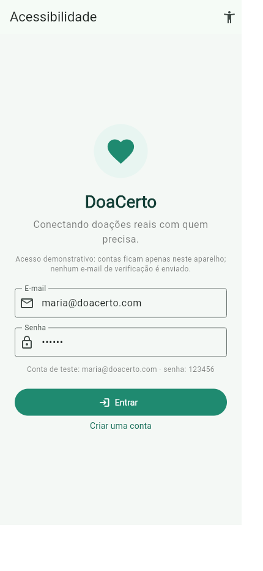
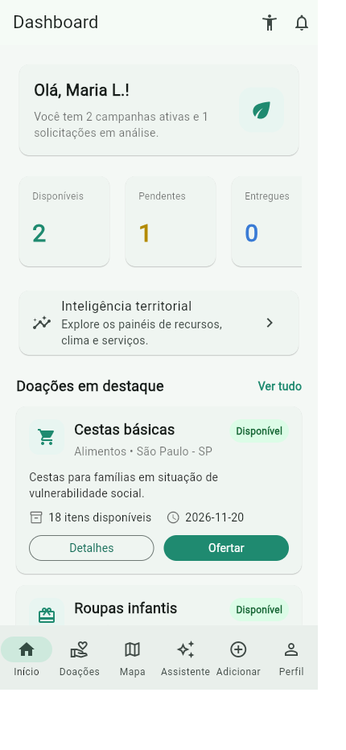
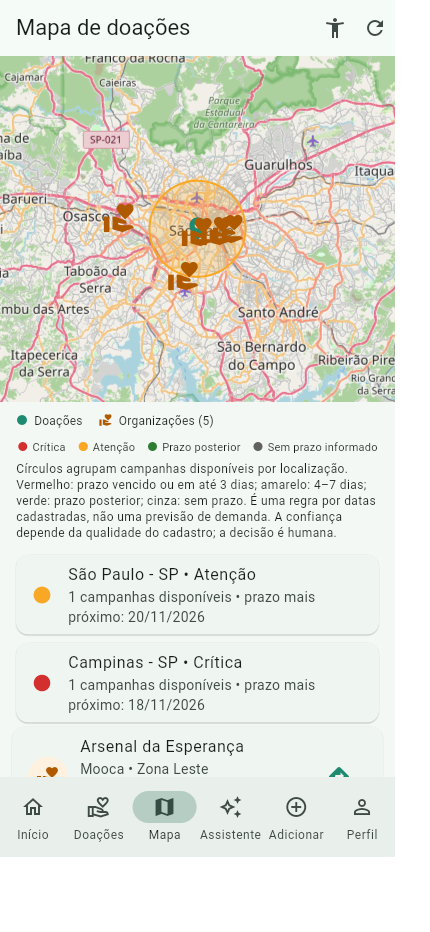
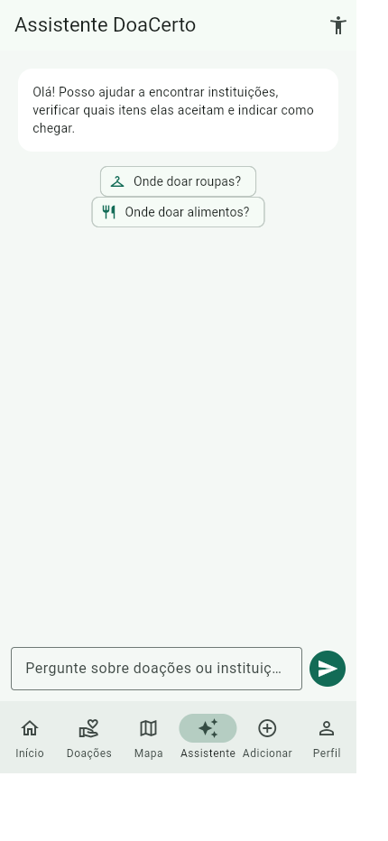
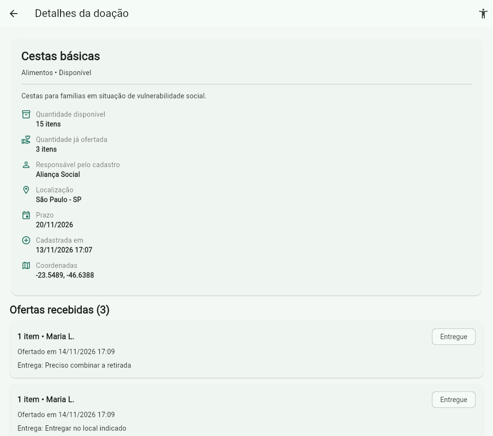
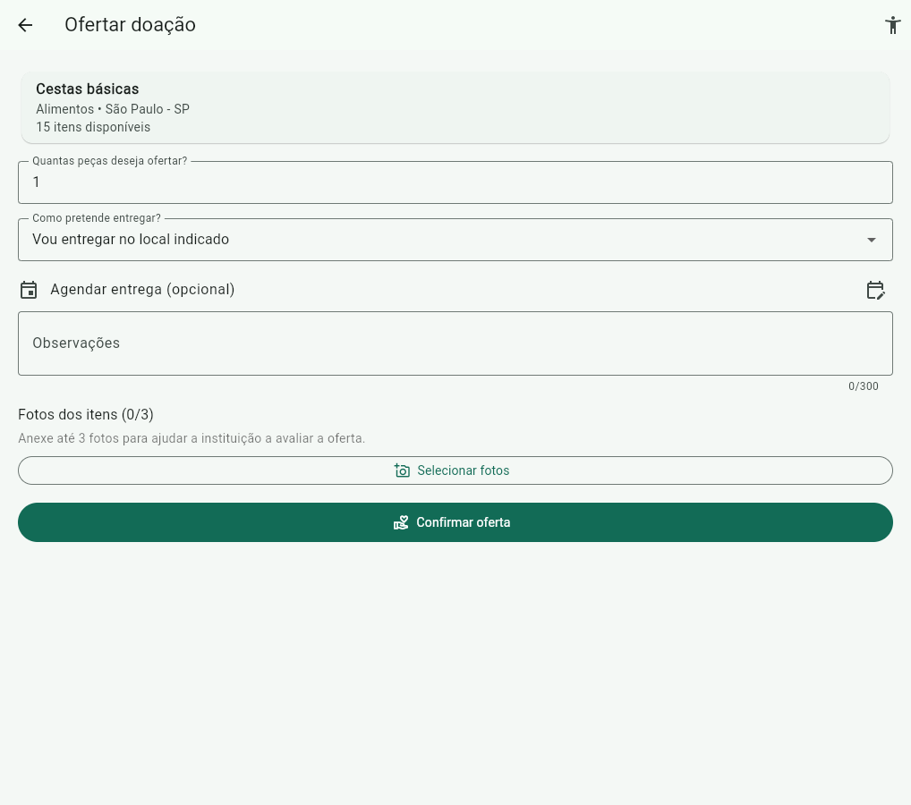

# 💚 DoaCerto Mobile

**Tecnologia que aproxima doações de quem precisa.** Aplicativo Flutter de inteligência territorial para apoiar cidadãos e organizações na identificação de campanhas, instituições e necessidades locais.

## Problema e público

Doações e campanhas podem não chegar a quem precisa por falta de informação sobre itens aceitos, localização e prazos. O DoaCerto foi criado para doadores, empresas e gestores que precisam consultar recursos e organizações por território. Espera-se facilitar o encontro entre doações e instituições e apoiar decisões mais informadas; o app não mede impacto causal nem substitui serviços públicos.

## Integrantes

| Integrante | RM |
|---|---:|
| Guilherme Ferraz de Medeiros | 564743 |
| Roberto Marques Moreira | 564935 |
| Gabriel Jorge Coutinho | 565441 |

## Demonstração visual

| Login | Dashboard |
|---|---|
|  |  |

| Mapa | Assistente |
|---|---|
|  |  |

| Cadastro de doação | Painel territorial |
|---|---|
|  |  |

| Detalhes da doação | Ofertar doação |
|---|---|
|  |  |

## Funcionalidades

- [x] Navegação entre áreas de doador e empresa e três painéis territoriais.
- [x] Consulta de organizações, campanhas, itens aceitos, endereços e rotas no mapa.
- [x] Detalhes completos das doações e ofertas parciais com quantidade, fotos, observações e agendamento.
- [x] Oferta confirmada registrada como entregue, atualizando o impacto pessoal e o histórico.
- [x] Alertas com evidências, confiança e limitações declaradas.
- [x] Assistente com recomendações de organizações.
- [x] Persistência local de doações, preferências e histórico.
- [x] Alto contraste e ajuste do tamanho do texto.
- [x] Cadastro e login demonstrativos, com validação e sessão local.

## Dados e alertas

- **Organizações:** obtidas de `GET /api/dados` na API Express. O diretório da API contém uma base reduzida de demonstração; endereços, coordenadas, itens aceitos e disponibilidade devem ser confirmados com as instituições.
- **Doações e recursos:** registros locais persistidos no aparelho. Ofertas confirmadas são consideradas entregues e aparecem no impacto pessoal e no histórico. O painel territorial agrega campanhas e ofertas cadastradas.
- **Benefício social:** o dashboard contabiliza itens e ofertas confirmados como entregues; isso não equivale a pessoas beneficiadas nem comprova entrega física.
- **Clima e procura por serviços:** séries sintéticas usadas para demonstrar gráficos e regras; não são observações, previsões meteorológicas, filas ou solicitações reais.
- **Urgência de campanhas:** usa o prazo cadastrado mais próximo: crítica se vencido ou em até 3 dias, atenção de 4 a 7 dias, prazo posterior acima de 7 dias e “sem prazo” quando não há data válida.
- **Alertas demonstrativos:** clima compara os três últimos valores sintéticos e indica alta apenas quando crescem em sequência; procura usa a mesma regra em seu índice sintético. Cada painel informa evidência, confiança e limitações.

Os resultados dependem da qualidade, atualidade e cobertura dos cadastros. Registros ausentes, prazos incorretos e cobertura desigual entre territórios podem enviesar comparações; disponibilidade de organizações não representa capacidade de atendimento. Alertas não são previsões confiáveis para emergências e nunca substituem fontes oficiais ou decisão humana. O app não estima pessoas beneficiadas, massa doada ou CO₂ evitado.

## Privacidade e inclusão

Doações, contas demonstrativas, preferências e conversas ficam no armazenamento local. O login de demonstração salva senha como hash com salt no aparelho; não há autenticação em servidor nem verificação por e-mail, portanto não use dados reais ou senhas reutilizadas. A API recebe mensagens enviadas ao assistente; sua chave de provedor permanece apenas na configuração do servidor.

O app não coleta a localização do dispositivo. A tela de consentimento explica o uso futuro previsto e permite registrar a preferência, sem ativar coleta. Alto contraste, escala de texto ajustável, componentes Material e rótulos semânticos apoiam acessibilidade. A interface foi verificada em dimensões mobile e Web.

## Tecnologias e decisões

- **Flutter e Dart:** uma base de código para Android e Web.
- **Provider:** compartilha o estado das doações, organizações e preferências entre telas.
- **SharedPreferences:** persiste dados demonstrativos e preferências localmente, sem exigir conta ou conexão para esses dados.
- **Express e HTTP:** API isolada para servir organizações e intermediar o assistente, mantendo a chave de IA fora do app.
- **flutter_map / OpenStreetMap:** mapa com marcadores de organizações e doações.
- **Gráficos próprios em Flutter:** exibem séries e indicadores sem tratar séries sintéticas como previsões.
- **url_launcher:** abre rotas externas para navegação.

## Como executar

Requisitos: Flutter/Dart compatíveis com `pubspec.yaml`; Node.js 20 ou superior apenas para executar a API local.

```powershell
git clone https://github.com/Gui-Ferraz-Medeiros/GS-doa-certo-mobile.git
Set-Location GS-doa-certo-mobile
flutter pub get
flutter run -d chrome --dart-define=DOACERTO_API_URL=https://doacerto-mobile-api.onrender.com
```

Para executar em emulador Android com a API remota:

```powershell
flutter run --dart-define=DOACERTO_API_URL=https://doacerto-mobile-api.onrender.com
```

Para gerar o APK:

```powershell
flutter build apk --release --dart-define=DOACERTO_API_URL=https://doacerto-mobile-api.onrender.com
```

O serviço gratuito pode suspender após inatividade; aguarde a primeira chamada. Para usar a API localmente, em outro terminal:

```powershell
Set-Location deployment/api
npm ci
Copy-Item .env.example .env
# Configure GEMINI_API_KEY apenas no arquivo local .env; nunca o versione.
npm start
```

Depois, execute o Flutter com `--dart-define=DOACERTO_API_URL=http://localhost:3001` (no emulador Android, use `http://10.0.2.2:3001`).

## Testes e release

```powershell
flutter analyze
flutter test
```

APK Android: [DoaCerto Mobile 1.0.0 — GitHub Releases](https://github.com/Gui-Ferraz-Medeiros/GS-doa-certo-mobile/releases/tag/v1.0.0).

## Vídeo de demonstração

Pendente de publicação. Adicionar aqui o link público para o vídeo de até 3 minutos.

## Repositório

[GS-doa-certo-mobile](https://github.com/Gui-Ferraz-Medeiros/GS-doa-certo-mobile)
